<div align="center">

# MedStock

### Offline-first hospital inventory & store management — Windows desktop + browser, from one codebase


-informational)


*A desktop application that replaces the daily Excel sheets used to track stock in hospital store rooms — with a full request-and-approval workflow, batch & expiry tracking, and a four-language, right-to-left-aware interface.*

**This repository is a project showcase.** It presents the product, its interface, and its engineering — the source code is proprietary and is not published here.

</div>

---

<div align="center">

### ▶️ A quick tour — the supervisor journey

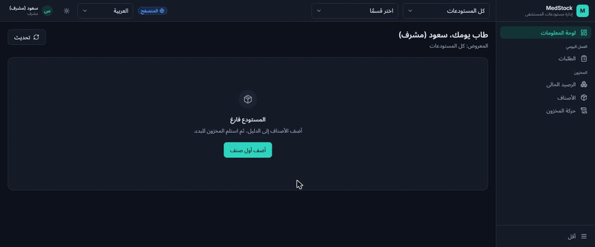

*Request → approval → issue → receipt, on synthetic demo data.*

</div>

---

## The problem

Hospital store rooms run on spreadsheets: a storekeeper types issues into Excel, wards phone in requests, expiry dates are tracked by hand, and nobody can say with confidence what is on the shelf or what it is worth. MedStock replaces that with a single, auditable system that the whole store — storekeepers, ward supervisors, and management — uses together.

It is **offline-first**: one PC holds the data and the others reach it over the hospital LAN, with no separate server to install and no cloud dependency. The *same application* can also be opened in a browser, and — when needed — exposed to the internet through a hardened tunnel behind an identity gate.

---

## The interface — a supervisor's journey

The walkthrough below follows a ward supervisor raising a supply request and signing for what arrives. *(Screens shown on synthetic demo data.)*

| | |
|:--:|:--|
| 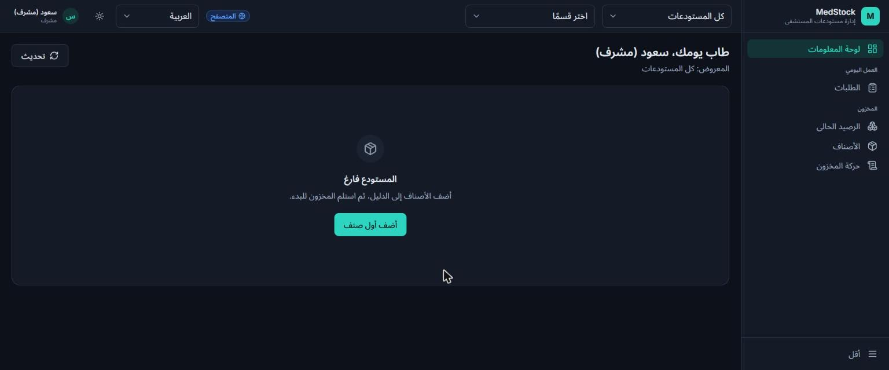 | **1 · Dashboard** — every role's home screen, scoped to the stores and wards they cover. |
| 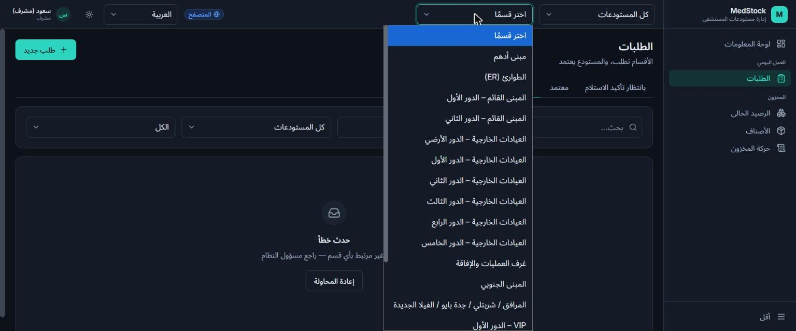 | **2 · Choose the ward** — a supervisor picks the area they are covering; their lists and requests follow the choice. |
| 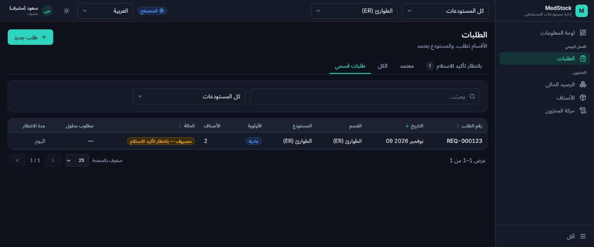 | **3 · Requests** — the ward's open and closed requests at a glance. |
| 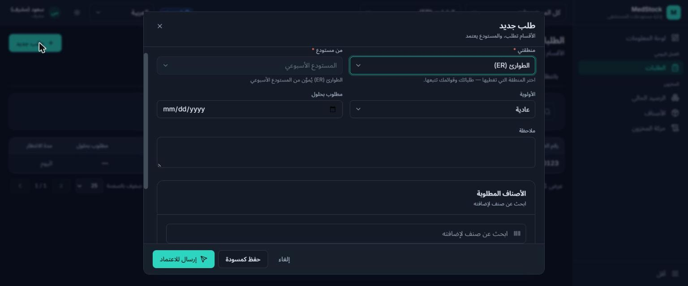 | **4 · New request** — build a request line by line. |
| 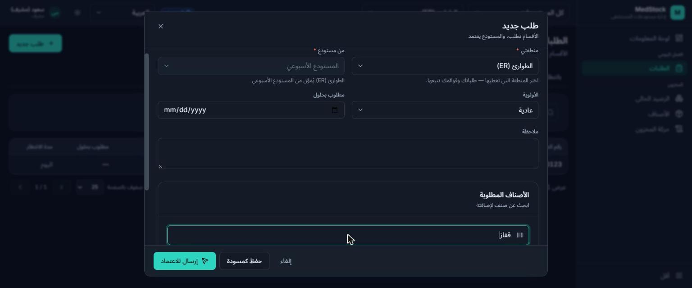 | **5 · Find an item** — fast, accent-aware catalogue search. |
| 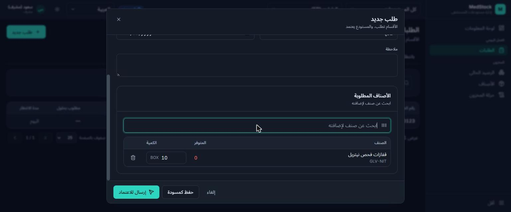 | **6 · Ready to send** — review before submitting for approval. |
| 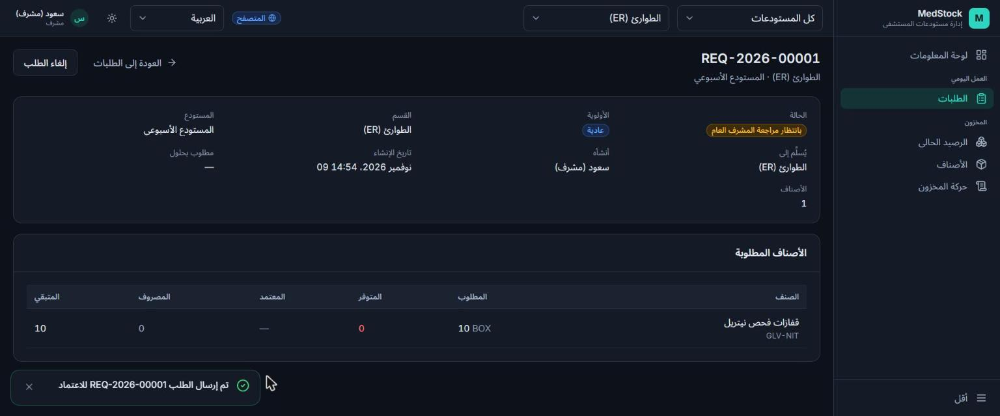 | **7 · Submitted** — the request enters the approval workflow. |
| 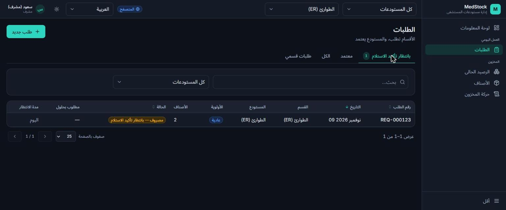 | **8 · Issued** — the store delivers against the approved request. |
| 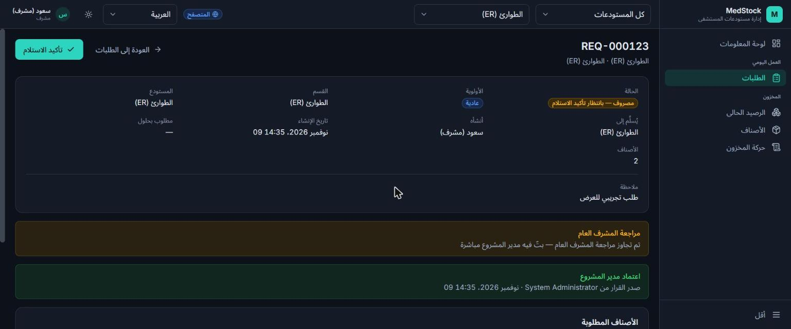 | **9 · Request detail** — full history: who approved, what was issued, every stage on the record. |
| 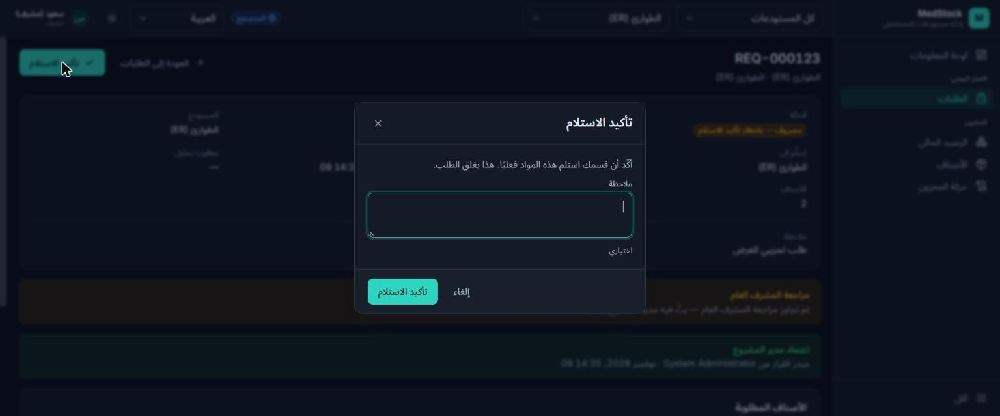 | **10 · Confirm receipt** — the ward signs for what physically arrived. |
| 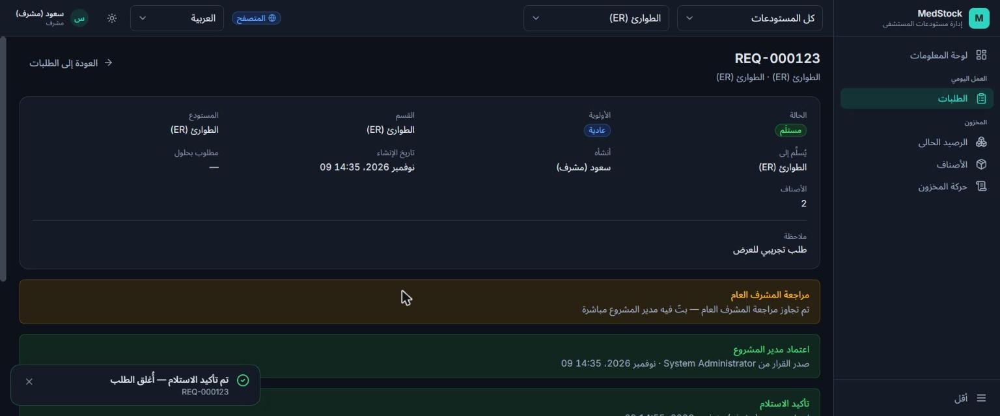 | **11 · Closed** — the loop is complete and fully audited. |

---

## What it does

| Capability | Detail |
|---|---|
| **Issue stock** | The screen that replaces the Excel sheet. Scan a barcode, type a quantity, press Enter — stock drops automatically, first-expiry-first-out. |
| **Receive stock** | Record deliveries against a supplier and invoice, with batch numbers and expiry dates. |
| **Request workflow** | A multi-stage request → review → approval → issue → receipt flow, each stage held by a different role by construction. |
| **Expiry tracking** | Every batch carries its expiry date; expired stock is never issued automatically. The dashboard and reports show what is expiring and what it is worth. |
| **Reorder list** | Per-store minimum and reorder levels, with suggested quantities based on real consumption over the last 90 days. |
| **Store hierarchy & transfers** | Move stock along the supply chain — main → weekly → area — with batch identity and expiry following the stock. |
| **Stock count** | Walk the shelves, enter counts, post the differences as adjustments. |
| **Reports** | Expiry, reorder, consumption by department, and stock valuation — all exportable to Excel and PDF. |
| **Audit trail** | Every movement records who did it, when, from which batch, and for which department. |

---

## Engineering highlights

- **One codebase, three surfaces.** Desktop (Electron IPC), LAN (HTTPS), and browser (`fetch`) all enter a single dispatcher through one validated contract — nothing below the transport layer knows which surface a request came from.
- **Contract-driven, drift-proof.** Every one of ~97 RPC methods is defined once with a runtime [Zod](https://zod.dev) input/output schema, its permission, and its mutation semantics; a compile-time check fails the build if the typed API and the runtime contract ever diverge.
- **Capability-based authorization.** A single role → capability table is the one source of truth used by *both* the server (to enforce) and the UI (to hide what a user cannot do), so the interface can never offer a button the server will refuse. It is pinned by an exhaustive method × role authorization-matrix test.
- **Offline-first, zero native dependencies.** Local storage uses the built-in `node:sqlite`, so there is no native module to compile or ship. One PC is the database; others connect over the LAN — same app, one setting changed.
- **Security by construction.** Passwords hashed with **scrypt**; per-install secrets sealed with the OS keystore (Windows DPAPI); **self-signed TLS with certificate pinning** (trust-on-first-use pairing) for LAN clients; strict CSP, hardened `BrowserWindow`, and Electron **fuses** flipped at package time; rotated, **redacted** JSON logs.
- **Internet-ready, carefully.** An optional loopback-only "tunnel door" lets a Cloudflare / ngrok agent publish the app behind an identity gate (e.g. Cloudflare Access) — without a router change or a public port.
- **Four languages, truly bilingual layout.** English, **العربية (right-to-left)**, Filipino, and हिन्दी — each user picks their own against one shared database, with RTL-aware layout and script-specific fonts.
- **Tested like production.** **7,730 automated tests** across 30 suites (authorization matrix, row-level scope, stock invariants, transports, TLS, backup/restore, migrations…), plus typecheck, locale/i18n completeness, a dependency audit, and a static Electron-misconfiguration scan, all wired into CI.
- **Safe data lifecycle.** Forward-only database migrations and an **AES-256-GCM encrypted backup** pipeline with a per-install recovery key.

---

## Architecture at a glance

```
          Desktop (IPC)        LAN client (HTTPS)        Browser (fetch /rpc)
                │                      │                          │
                └──────────────┬───────┴──────────────┬──────────┘
                               ▼                      ▼
                        one validated contract  (Zod schema · permission · per method)
                               │
                               ▼
                         dispatch()  ──►  handlers  ──►  core (business logic)  ──►  node:sqlite
                                           every call: schema-checked, permission-gated, audited
```

- `shared/` — the contract both sides compile against (API types, Zod schemas, the role→capability table, error→i18n mapping).
- `main/` — dispatcher, transports (IPC / HTTPS / web), core business logic, DB (migrations, encrypted backups), security (scrypt · DPAPI · TLS), redacted logging.
- `renderer/` — React UI that talks only to a minimal, locked-down preload bridge.

---

## Tech stack

**Desktop & build:** Electron 43 · electron-vite · Vite 7 · electron-builder (NSIS, per-user install) · `@electron/fuses`
**Front end:** React 18 · TypeScript 5 · React Router 7 · Zustand · TanStack Query · Tailwind CSS 3 · Recharts · lucide-react
**Data & domain:** `node:sqlite` · Zod · ExcelJS · JsBarcode
**Internationalization:** i18next · react-i18next · four locales (en / ar-RTL / fil / hi) with script-specific fonts
**Security:** scrypt · Windows DPAPI (safeStorage) · self-signed TLS with pinning (node-forge · selfsigned) · CSP · Electron fuses
**Quality:** a custom test harness (7,730 tests / 30 suites) · TypeScript strict typecheck · locale & i18n completeness checks · dependency audit · static Electron-security scan · GitHub Actions CI

---

## Status & ownership

MedStock is a real product in a **production pilot** at a hospital store operation (30–50 users). It is built for Windows, installs per-user (no admin rights needed on locked-down hospital PCs), and runs fully offline on the hospital's own network.

> **Proprietary.** This repository is a showcase of the product and its engineering. The source code is not included and is not licensed for reuse. Screenshots use synthetic demo data; no real patient, staff, or operational data appears anywhere in this repository.

<div align="center">

*Built with care for the people who keep hospital shelves stocked.*

</div>
